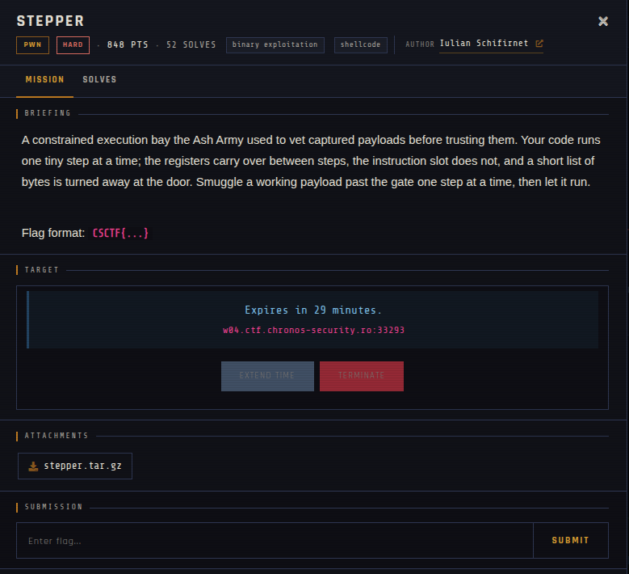
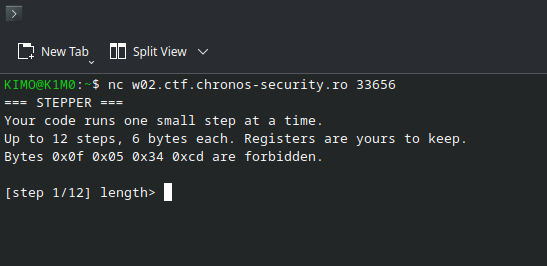

# Stepper 🐾

| | |
|---|---|
| **Competition** | 2026 Chronos Security CTF |
| **Category** | Pwn |
| **Points** | 848 |
| **Author** | Iulian Schifirnet |
| **Difficulty** | Hard |
| **Solves** | 52 |

## Description

> A constrained execution bay the Ash Army used to vet captured payloads before trusting them. Your code runs one tiny step at a time; the registers carry over between steps, the instruction slot does not, and a short list of bytes is turned away at the door. Smuggle a working payload past the gate one step at a time, then let it run.

Flag format: `CSCTF{...}`

Tags: binary exploitation, shellcode

## Files

| File | Notes |
|------|-------|
| `files/stepper.tar.gz` | Archive (5,687 bytes) containing `stepper` (16,840 bytes, the challenge binary) and `stepper.c` (5,039 bytes, source) |

## Remote service

Per-team ephemeral instance (e.g. `w04.ctf.chronos-security.ro:<port>`), offline now since the event/instance has ended.

## Screenshots

## Solve

⚠️ Spoilers: solve script and notes

- Solve scripts: [`solve/exploit.py`](solve/exploit.py) and [`solve/exploit2.py`](solve/exploit2.py) (near-identical; `exploit2.py` resolves the host via `getaddrinfo` first)
- Technique: up to 12 steps of ≤6 bytes each are sent in, registers persist across steps but the instruction pointer doesn't, and bytes `0x0f 0x05 0x34 0xcd` are banned (blocking direct `syscall`/`int 0x80`/etc). The steps build `"/bin/sh"` into writable memory byte-by-byte via `mov [rip+off], reg`, recover a self-relative pointer to it with a `call $+0; pop rdi` + `add rdi` trick, then set up `execve` registers and `jmp` into a previously-written raw `syscall` to avoid the banned bytes directly in a step.
- No flag was captured in the material you sent — only the exploit and a netcat-session screenshot.
- Usage: `python3 exploit.py remote <host> <port>` (or run with no args to test against a local `./stepper` binary).

⚠️ No host/port is hardcoded in these two (they're passed as CLI args), so nothing to strip there.

---
Source: 2026 Chronos Security CTF
Archived by [StrayHound](https://strayhound.team) 🐾