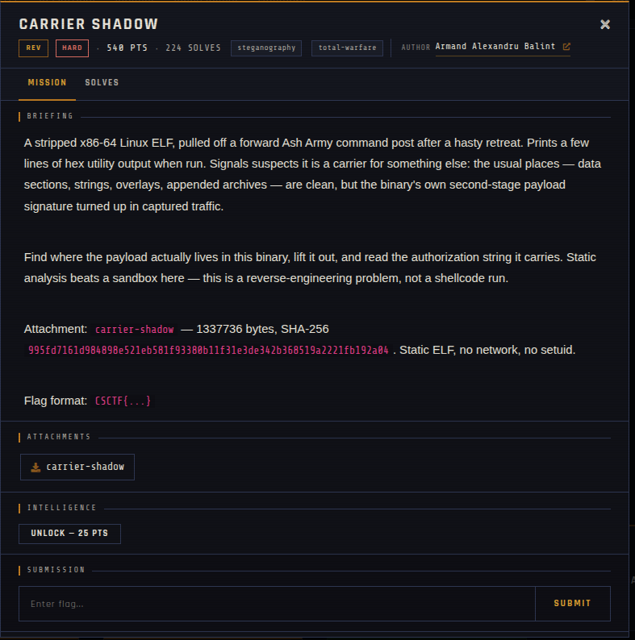

# Carrier Shadow 🐾

| | |
|---|---|
| **Competition** | CSCTF 2026: Total Warfare |
| **Category** | Reverse Engineering |
| **Points** | 540 |
| **Author** | Armand Alexandru Balint |
| **Difficulty** | Hard |
| **Solves** | 224 |
| **Hint** | In-platform hint available for 25 pts |

## Description

> A stripped x86-64 Linux ELF, pulled off a forward Ash Army command post after a hasty retreat. Prints a few lines of hex utility output when run. Signals suspects it is a carrier for something else: the usual places — data sections, strings, overlays, appended archives — are clean, but the binary's own second-stage payload signature turned up in captured traffic.
>
> Find where the payload actually lives in this binary, lift it out, and read the authorization string it carries. Static analysis beats a sandbox here — this is a reverse-engineering problem, not a shellcode run.
>
> Attachment: `carrier-shadow` — 1337736 bytes, SHA-256 `995fd7161d984898e521eb581f93380b11f31e3de342b368519a2221fb192a04`. Static ELF, no network, no setuid.

Flag format: `CSCTF{...}`

## Files

| File | Notes |
|------|-------|
| `files/carrier-shadow` | **Not included in the material you sent** — only the mission-page screenshot was provided. Per the brief: 1,337,736 bytes, SHA-256 `995fd7161d984898e521eb581f93380b11f31e3de342b368519a2221fb192a04`, static x86-64 Linux ELF, no network, no setuid. Download it from the challenge page and place it in `files/`. |

## Remote service

None — offline static-analysis task (the brief explicitly says static analysis beats a sandbox here).

## Screenshots

---
Source: CSCTF 2026: Total Warfare
Archived by [StrayHound](https://strayhound.team) 🐾