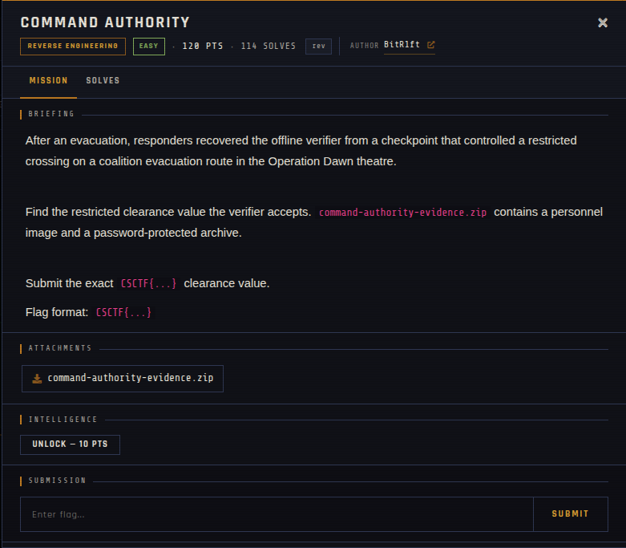

# Command Authority 🐾

| | |
|---|---|
| **Competition** | CSCTF 2026: Total Warfare |
| **Category** | Reverse Engineering |
| **Points** | 120 |
| **Author** | BitR1ft |
| **Difficulty** | Easy |
| **Solves** | 114 |
| **Hint** | In-platform hint available for 10 pts |

## Description

> After an evacuation, responders recovered the offline verifier from a checkpoint that controlled a restricted crossing on a coalition evacuation route in the Operation Dawn theatre.
>
> Find the restricted clearance value the verifier accepts. `command-authority-evidence.zip` contains a personnel image and a password-protected archive.
>
> Submit the exact `CSCTF{...}` clearance value.

Flag format: `CSCTF{...}`

## Files

| File | Notes |
|------|-------|
| `files/command-authority-evidence.zip` | 11,968 bytes · SHA-256 `8d48474b9ff2a03f8c407294c42e8530d7fa865fbb5ebf4de653350bc557d4ca` |

## Remote service

None — offline static-analysis task.

## Screenshots

---
Source: CSCTF 2026: Total Warfare
Archived by [StrayHound](https://strayhound.team) 🐾
