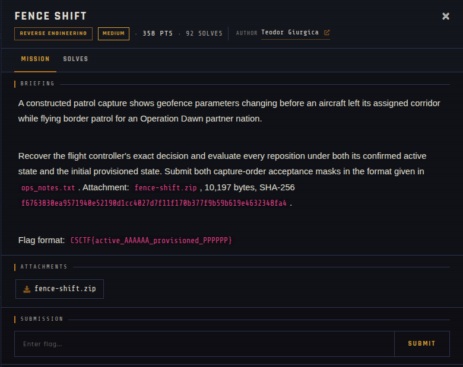

# Fence Shift 🐾

| | |
|---|---|
| **Competition** | CSCTF 2026: Total Warfare |
| **Category** | Reverse Engineering |
| **Points** | 358 |
| **Author** | Teodor Giurgica |
| **Difficulty** | Medium |
| **Solves** | 92 |

## Description

> A constructed patrol capture shows geofence parameters changing before an aircraft left its assigned corridor while flying border patrol for an Operation Dawn partner nation.
>
> Recover the flight controller's exact decision and evaluate every reposition under both its confirmed active state and the initial provisioned state. Submit both capture-order acceptance masks in the format given in `ops_notes.txt`. Attachment: `fence-shift.zip`, 10,197 bytes, SHA-256 `f6763830ea9571940e52190d1cc4027d7f11f170b377f9b59b619e4632348fa4`.

Flag format: `CSCTF{active_AAAAAA_provisioned_PPPPP}`

## Files

| File | Notes |
|------|-------|
| `files/fence-shift.zip` | 10,197 bytes · SHA-256 `f6763830ea9571940e52190d1cc4027d7f11f170b377f9b59b619e4632348fa4` (per the brief, contains `ops_notes.txt` describing the submission format) |

## Remote service

None — offline static-analysis task.

## Screenshots

---
Source: CSCTF 2026: Total Warfare
Archived by [StrayHound](https://strayhound.team) 🐾
