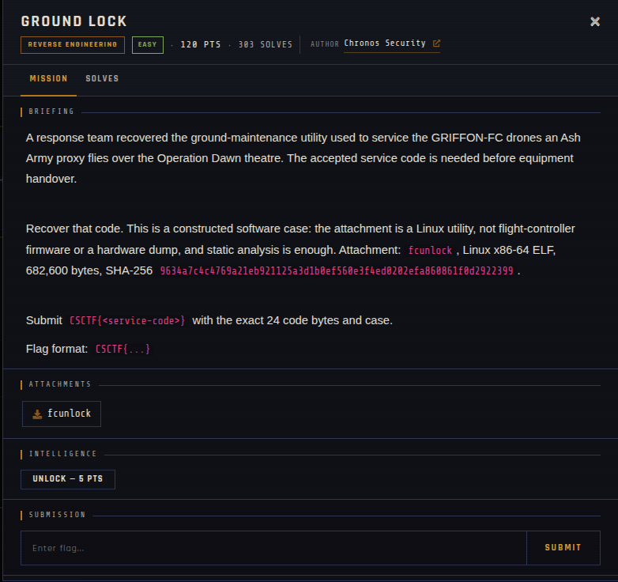

# Ground Lock 🐾

| | |
|---|---|
| **Competition** | CSCTF 2026: Total Warfare |
| **Category** | Reverse Engineering |
| **Points** | 120 |
| **Author** | Chronos Security |
| **Difficulty** | Easy |
| **Solves** | 303 |
| **Hint** | In-platform hint available for 5 pts |

## Description

> A response team recovered the ground-maintenance utility used to service the GRIFFON-FC drones an Ash Army proxy flies over the Operation Dawn theatre. The accepted service code is needed before equipment handover.
>
> Recover that code. This is a constructed software case: the attachment is a Linux utility, not flight-controller firmware or a hardware dump, and static analysis is enough. Attachment: `fcunlock`, Linux x86-64 ELF, 682,600 bytes, SHA-256 `9634a7c4c4769a21eb921125a3d1b0ef560e3f4ed0202efa860861f0d2922399`.
>
> Submit `CSCTF{<service-code>}` with the exact 24 code bytes and case.

Flag format: `CSCTF{...}`

## Files

| File | Notes |
|------|-------|
| `files/fcunlock` | Linux x86-64 ELF, statically linked, stripped · 682,600 bytes · SHA-256 `9634a7c4c4769a21eb921125a3d1b0ef560e3f4ed0202efa860861f0d2922399` |

## Remote service

None — offline static-analysis task.

## Screenshots

---
Source: CSCTF 2026: Total Warfare
Archived by [StrayHound](https://strayhound.team) 🐾
