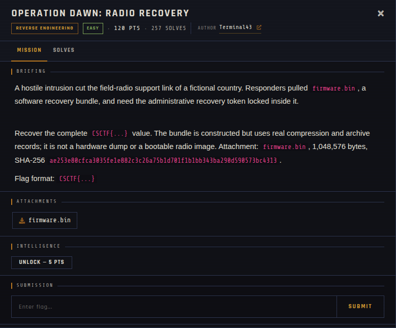

# Operation Dawn: Radio Recovery 🐾

| | |
|---|---|
| **Competition** | CSCTF 2026: Total Warfare |
| **Category** | Reverse Engineering |
| **Points** | 120 |
| **Author** | Terminal43 |
| **Difficulty** | Easy |
| **Solves** | 257 |
| **Hint** | In-platform hint available for 5 pts |

## Description

> A hostile intrusion cut the field-radio support link of a fictional country. Responders pulled `firmware.bin`, a software recovery bundle, and need the administrative recovery token locked inside it.
>
> Recover the complete `CSCTF{...}` value. The bundle is constructed but uses real compression and archive records; it is not a hardware dump or a bootable radio image. Attachment: `firmware.bin`, 1,048,576 bytes, SHA-256 `ae253e80cfca3035fe1e882c3c26a75b1d701f1b1bb343ba290d590573bc4313`.

Flag format: `CSCTF{...}`

## Files

| File | Notes |
|------|-------|
| `files/firmware.bin` | 1,048,576 bytes · SHA-256 `ae253e80cfca3035fe1e882c3c26a75b1d701f1b1bb343ba290d590573bc4313` (contains real compression/archive records, not a hardware/radio image) |

## Remote service

None — offline static-analysis task.

## Screenshots

---
Source: CSCTF 2026: Total Warfare
Archived by [StrayHound](https://strayhound.team) 🐾
