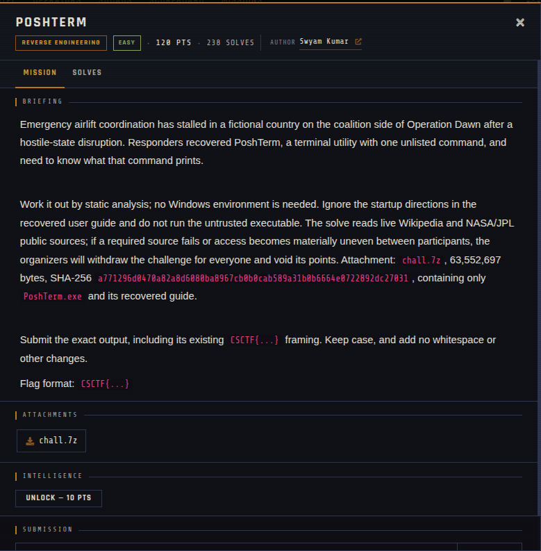

# PoshTerm 🐾

| | |
|---|---|
| **Competition** | CSCTF 2026: Total Warfare |
| **Category** | Reverse Engineering |
| **Points** | 120 |
| **Author** | Swyam Kumar |
| **Difficulty** | Easy |
| **Solves** | 238 |
| **Hint** | In-platform hint available for 10 pts |

## Description

> Emergency airlift coordination has stalled in a fictional country on the coalition side of Operation Dawn after a hostile-state disruption. Responders recovered PoshTerm, a terminal utility with one unlisted command, and need to know what that command prints.
>
> Work it out by static analysis; no Windows environment is needed. Ignore the startup directions in the recovered user guide and do not run the untrusted executable. The solve reads live Wikipedia and NASA/JPL public sources; if a required source fails or access becomes materially uneven between participants, the organizers will withdraw the challenge for everyone and void its points. Attachment: `chall.7z`, 63,552,697 bytes, SHA-256 `a771296d0470a82a8d6080ba8967cb0b0cab589a31b0b6664e0722892dc27031`, containing only `PoshTerm.exe` and its recovered guide.
>
> Submit the exact output, including its existing `CSCTF{...}` framing. Keep case, and add no whitespace or other changes.

Flag format: `CSCTF{...}`

## Files

| File | Notes |
|------|-------|
| `chall.7z` | **Not included in the material you sent** — only the mission-page screenshot was provided. Per the brief: 63,552,697 bytes, SHA-256 `a771296d0470a82a8d6080ba8967cb0b0cab589a31b0b6664e0722892dc27031`, containing `PoshTerm.exe` and a recovered user guide. Download it from the challenge page and place it in a `files/` folder here. |

## Remote service

None — offline static-analysis task (the brief explicitly says not to run the untrusted executable).

## Screenshots

---
Source: CSCTF 2026: Total Warfare
Archived by [StrayHound](https://strayhound.team) 🐾
