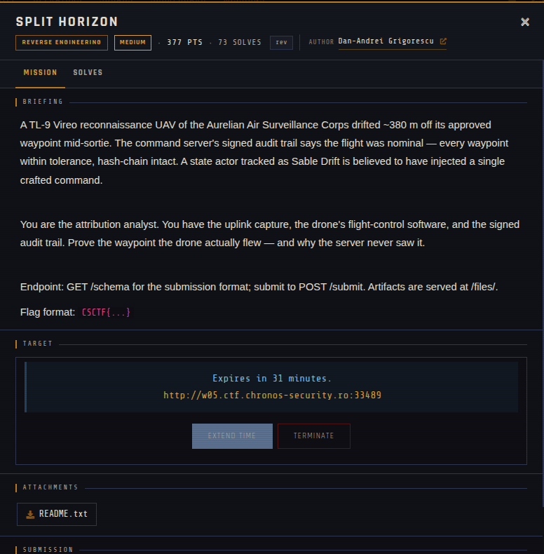
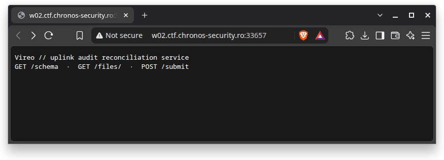
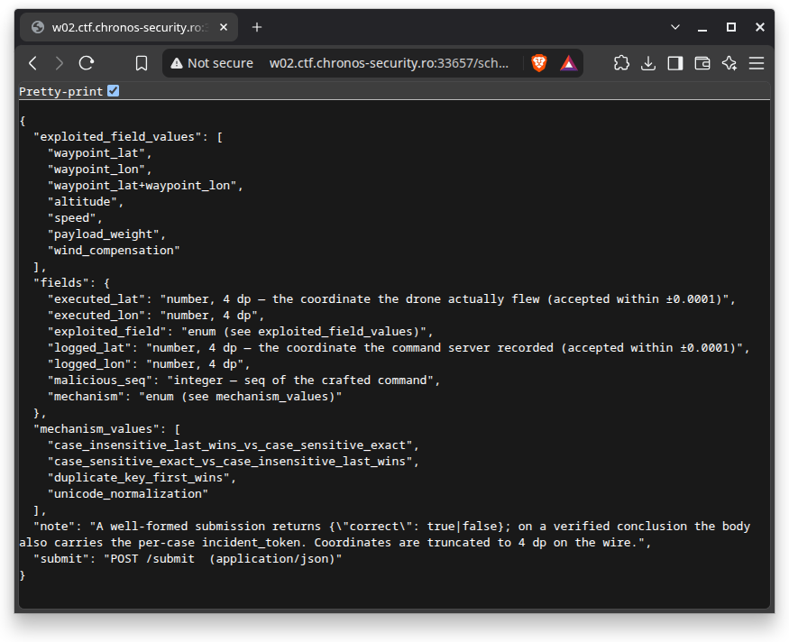

# Split Horizon 🐾

| | |
|---|---|
| **Competition** | CSCTF 2026: Total Warfare |
| **Category** | Reverse Engineering |
| **Points** | 377 |
| **Author** | Dan-Andrei Grigorescu |
| **Difficulty** | Medium |
| **Solves** | 73 |

## Description

> A TL-9 Vireo reconnaissance UAV of the Aurelian Air Surveillance Corps drifted ~380 m off its approved waypoint mid-sortie. The command server's signed audit trail says the flight was nominal — every waypoint within tolerance, hash-chain intact. A state actor tracked as Sable Drift is believed to have injected a single crafted command.
>
> You are the attribution analyst. You have the uplink capture, the drone's flight-control software, and the signed audit trail. Prove the waypoint the drone actually flew — and why the server never saw it.
>
> Endpoint: GET /schema for the submission format; submit to POST /submit. Artifacts are served at `/files/`.

Flag format: `CSCTF{...}`

## Files

Per the attached `README.txt`: *"Split Horizon container challenge — player artifacts are generated per-team and served by the container at `/files/` (`session.pcap`, `vireo-ctl.dll`, `command-server.go`, `manifest.json`, `audit.log`, `sigint.txt`). Nothing is attached statically."*

The files below are the set served to one specific team instance, archived as-is — they won't be byte-identical to another team's run, but they were generated by the same unmodified challenge container.

| File | Notes |
|------|-------|
| `files/README.txt` | Organizer's note on how artifacts are served (quoted above) |
| `files/session.pcap` | 17,623 bytes · SHA-256 `25775683743fe40ac3794234e836202e1fe991ef977e47378a3fad5f16a1c03f` — the uplink capture |
| `files/vireo-ctl.dll` | 9,728 bytes · SHA-256 `7461c56c01c81caf918e9bb2d807818a632208d0e89f1ab88ead59d8dc157460` — drone flight-control software (.NET assembly) |
| `files/command-server.go` | 5,637 bytes · SHA-256 `e853a7ff7893dd43c4bc52b81c6b9f6445275067abe6d3bdd997877070bc247f` — command server source |
| `files/manifest.json` | 323 bytes · SHA-256 `db9866fd31efa9cf4a8bf24bf813ae9b293723d488c838d6be1831ab270b61ab` — mission manifest (approved waypoint/altitude, validation tolerance, audit pubkey) |
| `files/audit.log` | 2,210 bytes · SHA-256 `c59c258e980ccd14e616b400b7f3338d5c8b7f605c8db554f41628e433b60076` — signed audit trail |
| `files/sigint.txt` | 507 bytes · SHA-256 `0e1ba8e22a97d9ff1b997418c399b69acbf4c1649001d534d9d699a10a88dba5` — SIGINT summary, corroborating evidence only |
| `files/schema.json` | 981 bytes · SHA-256 `fca722dccff101875ee43247e8e0b6ddb6974c0a8f28920415b236bfd6ec972f` — submission schema (also served live at `GET /schema`) |

## Remote service

Per-team ephemeral instance (e.g. `http://w05.ctf.chronos-security.ro:33489`), offline now since the event/instance has ended. `GET /schema` for the submission format, `POST /submit` to submit, artifacts served at `/files/`.

## Screenshots

---
Source: CSCTF 2026: Total Warfare
Archived by [StrayHound](https://strayhound.team) 🐾
