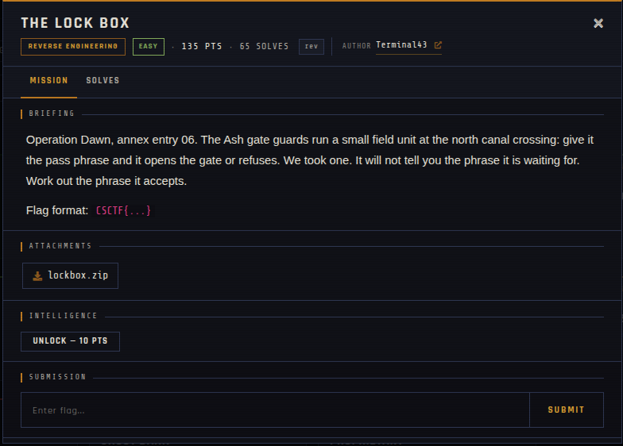

# The Lock Box 🐾

| | |
|---|---|
| **Competition** | CSCTF 2026: Total Warfare |
| **Category** | Reverse Engineering |
| **Points** | 135 |
| **Author** | Terminal43 |
| **Difficulty** | Easy |
| **Solves** | 65 |
| **Hint** | In-platform hint available for 10 pts |

## Description

> Operation Dawn, annex entry 06. The Ash gate guards run a small field unit at the north canal crossing: give it the pass phrase and it opens the gate or refuses. We took one. It will not tell you the phrase it is waiting for.
>
> Work out the phrase it accepts.

Flag format: `CSCTF{...}`

## Files

| File | Notes |
|------|-------|
| `files/lockbox.zip` | 14,584 bytes · SHA-256 `d805f832eb72f56b20ef2e55de4757430e4125545a132285a41b46fbdb0f232c` |

## Remote service

None — offline static-analysis task.

## Screenshots

---
Source: CSCTF 2026: Total Warfare
Archived by [StrayHound](https://strayhound.team) 🐾
