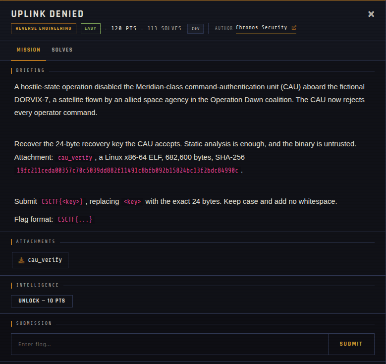

# Uplink Denied 🐾

| | |
|---|---|
| **Competition** | CSCTF 2026: Total Warfare |
| **Category** | Reverse Engineering |
| **Points** | 120 |
| **Author** | Chronos Security |
| **Difficulty** | Easy |
| **Solves** | 113 |
| **Hint** | In-platform hint available for 10 pts |

## Description

> A hostile-state operation disabled the Meridian-class command-authentication unit (CAU) aboard the fictional DORVIX-7, a satellite flown by an allied space agency in the Operation Dawn coalition. The CAU now rejects every operator command.
>
> Recover the 24-byte recovery key the CAU accepts. Static analysis is enough, and the binary is untrusted. Attachment: `cau_verify`, a Linux x86-64 ELF, 682,600 bytes, SHA-256 `19fc211ceda00357c70c5039dd882f11491c8bfb092b15824bc13f2bdc84990c`.
>
> Submit `CSCTF{<key>}`, replacing `<key>` with the exact 24 bytes. Keep case and add no whitespace.

Flag format: `CSCTF{...}`

> ⚠️ **Safety note:** the brief itself describes this binary as untrusted. Open/run it only inside a VM or sandbox, never on your main system.

## Files

| File | Notes |
|------|-------|
| `files/cau_verify` | Linux x86-64 ELF, statically linked, stripped · 682,600 bytes · SHA-256 `19fc211ceda00357c70c5039dd882f11491c8bfb092b15824bc13f2bdc84990c` |

## Remote service

None — offline static-analysis task.

## Screenshots

---
Source: CSCTF 2026: Total Warfare
Archived by [StrayHound](https://strayhound.team) 🐾
